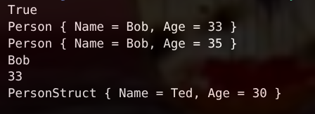

# КТ №14 — record и record struct

**Вариант 1 — Person / PersonStruct**

- `public record Person(string Name, int Age);`
- Создайте два экземпляра `Person` с одинаковыми значениями и продемонстрируйте, что `==` возвращает `true`.
- Используйте `with`, чтобы создать копию с другим `Age`, и выведите оригинал и копию, доказав, что оригинал не изменился.
- Продеконструируйте `Person` в переменные `name` и `age`.
- Объявите `public record struct PersonStruct(string Name, int Age);` и продемонстрируйте, что `Age` можно изменить напрямую (`personStruct.Age = 30;`) — в отличие от `Person.Age`.

## Проверочные ключи

| Действие | Ожидаемый результат |
|---|---|
| `new Person("Bob", 33) == new Person("Bob", 33)` | `True` |
| `p1 with { Age = 35 }` | новый объект, `Age == 35`; оригинал остался с `Age == 33` |
| `var (name, age) = p1;` | `name` и `age` получают значения свойств |
| `p3.Age = 30;` напрямую | компилируется и работает (в отличие от `Person.Age`, у которого `init`) |

## Результат выполнения

